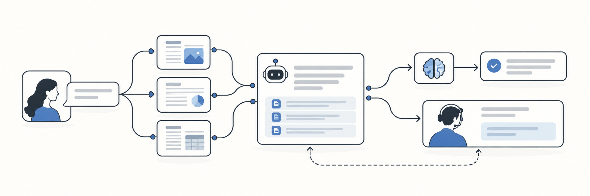

# helpdesk-agent

An AI helpdesk workflow for StyleDesk, a fictional B2B SaaS company. The
project explores how customer-support automation can retrieve company
knowledge, produce evidence-backed draft answers, decide when a human
should take over, and recover from incorrect or unsafe actions while
preserving accountability.

The design stance is selective automation with an approval-based copilot
first: the agent drafts, a human approves, and anything outside the
documented safe zone routes to a person with an explicit reason. Every
number in this README comes from a real run of the pipeline over a
100-ticket human-reviewed golden set, and the result files are in
`evals/` so anyone can regenerate them.

## Features

- FastAPI service with `GET /health` and `POST /tickets/answer`.
- BM25 retrieval over a 30-article StyleDesk knowledge base
  (`data/tickets.json`) covering billing, account, product bugs, and
  how-tos (`app/kb.py`).
- Deterministic extractive mock provider (`app/answer.py`): answers are
  built from the top retrieved article with citations, no paid API keys.
- Confidence gate on a normalized BM25 score, calibrated on labeled data
  (see Eval results). Below the threshold the ticket hands off to a human
  instead of guessing.
- Guardrails on every ticket (`app/guardrails.py`): prompt-injection
  detection, PII redaction before storage, unsupported-claim checks
  against the retrieved articles, an evidence-overlap gate for weak
  retrieval, and contradictory-policy detection.
- Persistent approval queue (`app/queue.py`, SQLite at
  `data/helpdesk.db`): every answer is stored as a draft with retrieved
  evidence, routing reason, confidence, model and prompt versions, and
  timings. Reviewers approve, edit, send, requeue, assign, supersede, or
  invalidate each item. Every state change is logged with timestamp,
  actor, and reason.
- Recovery paths: `supersede` withdraws a sent reply and reopens the
  ticket as a pending draft with history preserved on both items;
  `invalidate` discards unsent drafts; identical ticket text within 10
  minutes returns the existing queue id, so client retries never create
  duplicate drafts.

## Architecture

```
ticket -> guardrail routing (app/guardrails.py: classify)
       -> BM25 retrieval, top 5 (app/kb.py)
       -> confidence gate (only demotes answers, never overwrites a
          policy routing reason)
       -> contradictory-evidence check
       -> evidence-overlap gate
       -> draft from top article + citations (app/answer.py)
       -> unsupported-claim check (flags needs_review)
       -> whitelist match (data/auto_whitelist.json)
       -> PII redaction
       -> approval queue (app/queue.py) -> human approve / edit / send
```

Pipeline entry point: `pipeline_ticket()` in `app/answer.py`. HTTP layer:
`app/main.py`. Queue endpoints: `GET /queue`, `GET /queue/{id}`,
`POST /queue/{id}/approve|send|edit|requeue|assign|supersede|invalidate`,
and `GET /queue/{id}/handoff` for a structured takeover summary.

## Setup

```bash
python -m venv .venv && source .venv/bin/activate   # Windows: .venv\Scripts\activate
python -m pip install -r requirements.txt
python -m uvicorn app.main:app --reload
```

If startup reports `ModuleNotFoundError: No module named 'rank_bm25'`,
install the requirements and launch the server with the same virtual
environment interpreter:

```bash
.venv/bin/python -m pip install -r requirements.txt
.venv/bin/python -m uvicorn app.main:app --reload
```

## Usage

```bash
curl -X POST http://localhost:8000/tickets/answer -H "Content-Type: application/json" -d '{
  "ticket_id": "T-1001",
  "subject": "How do I update my credit card?",
  "body": "My card expired and I need to replace the payment method."
}'
```

Response fields: `ticket_id`, `answer`, `citations`, `confidence`,
`action` (`answered`, `handoff`, or `escalate`), `handoff_reason`,
`queue_id`, `auto_sendable`, `routing_reason`, and `needs_review`.

Review a draft:

```bash
curl http://localhost:8000/queue                 # open items
curl -X POST http://localhost:8000/queue/1/approve
curl -X POST http://localhost:8000/queue/1/send
curl http://localhost:8000/queue/1/handoff       # takeover summary
```

Run the evaluations:

```bash
python -m evals.run_eval    # Day 3: golden-set eval + threshold sweep
python -m evals.run_day4    # Day 4: curve + cost routing + reviewer effort
python -m pytest -q         # 49 tests
```

## Eval results

Golden set (`data/golden_set.json`): 100 human-reviewed tickets with
labeled expected actions and source articles: 60 KB-covered (2 per
article), 15 intentional KB gaps, 10 policy-routing handoffs, 8
contradictory-policy cases, 7 prompt injections.

Day 3, calibration (`evals/results_day3.md`):

- Retrieval recall@5 on covered cases: 1.0000.
- The confidence threshold moved from 0.35 to 0.94, chosen by sweep as
  the highest coverage whose answered precision stays at or above 95
  percent. At 0.94: coverage 63 percent, answered precision 95.2
  percent, action accuracy 97 percent. At the old 0.35: precision 88.2
  percent, action accuracy 92 percent, coverage 68 percent.
- Honest framing: the confidence is a normalized BM25 score, not a
  calibrated probability. 0.94 is an operating point measured on this
  golden set, not a probability guarantee.
- Calibration also exposed a pipeline bug, now fixed: the confidence
  gate used to overwrite policy routing reasons (billing dispute,
  account action) with `low_retrieval_confidence`. The gate now only
  demotes answers.
- Known remaining failures at 0.94: 2 of 15 KB-gap tickets still get
  answered from loosely related articles, and 1 of 8 contradiction
  cases slips through when one policy article falls out of the top 5
  retrieval results.

Day 4, curve, cost, and effort (`evals/results_day4_curve.md`,
`evals/results_day4_cost.md`, `evals/results_day4_effort.md`):

- Quality-vs-coverage curve: answered precision climbs from 88.2
  percent at threshold 0.35 to 95.2 percent at 0.94 and 100 percent at
  0.96, while coverage falls from 68 to 63 to 56 percent. Scores cluster
  near the top of the range: the steepest single step drops coverage 34
  points between thresholds 0.97 and 0.98.
- Cost-aware routing: outcomes are priced in human minutes (correct
  draft 1 min skim review, wrong draft 21 min with rework, handoff 8
  min, escalation 10 min; $30/hour loaded). Expected cost per ticket is
  4.98 min at 0.35, 4.33 min at the shipped 0.94, and 4.22 min ($2.11)
  at the cost-optimal 0.96, which reaches 100 percent precision with
  zero wrong answers.
- Reviewer effort: at the shipped 0.94 point, the 100 golden tickets
  take 433 human minutes (63 draft skims, 3 wrong-draft reworks, 30
  handoffs, 7 escalations) against a fully manual baseline of 800
  minutes, a 45.9 percent saving. At 0.96: 422 minutes, 47.2 percent
  saved. These are estimates from labeled data under the stated minute
  assumptions, not a time study.
- Tests: 49 passing. The Day 4 tests cover the curve shape, the cost
  model math, and the effort accounting.

## Automation policy

This section is the contract the code implements. It is deliberately
explicit, because "the AI handles support" is not a policy.

**Nothing customer-facing auto-sends.** Every answer the agent produces
becomes a draft in the approval queue. A human reviewer approves, edits,
or rejects each draft before anything reaches a customer. The queue is
the product; the model is a drafting assistant inside it.

**The auto-reply whitelist is narrow on purpose.** Only 5 documented
how-to intents in `data/auto_whitelist.json` (reset password, enable
2FA, connect Slack, create a queue, build a weekly report) may ever be
marked `auto_sendable`, and an intent matches only when a keyword
pattern appears in the ticket AND the top retrieved article is that
intent's documented article. Even a whitelisted draft still lands in the
queue as a draft in this build; `auto_sendable` is a label a future
deployment could act on, not a send path that exists today.

**Some categories always go to a human**, with the reason stored on the
queue item:

- Billing disputes: `billing_dispute_requires_records`. A dispute needs
  account records the knowledge base cannot confirm.
- Bug reports: `bug_report_needs_repro`. A malfunction needs
  reproduction details, not a documented answer.
- Account changes: `account_change_requires_auth`. Deletes, removals,
  and email changes need identity verification first.

**Guardrails run before anything is stored.** Prompt-injection attempts
escalate to a human (`suspected_prompt_injection`) and nothing in the
ticket text is followed. PII (emails, phone numbers, card-like
sequences) is redacted from every stored copy; the original text is
never persisted. A draft whose numbers or names appear in no retrieved
article is flagged `needs_review` for unsupported claims. If retrieval
surfaces two policies that contradict each other and the ticket invokes
both, the ticket hands off as `contradictory_policy` instead of picking
a side.

**Below the line means a human, not a guess.** Tickets under the 0.94
confidence threshold, or with too little evidence overlap with the top
article, hand off with `low_retrieval_confidence`. Handoffs and
escalations carry a structured takeover summary (`GET
/queue/{id}/handoff`) so the human starts with the evidence, the routing
reason, and the history, not a blank page.

**Recovery is part of the policy.** A sent reply that turns out wrong
can be superseded: the reply is withdrawn, the ticket reopens as a
pending draft, and history is preserved on both items. Unsent drafts can
be invalidated. Duplicate intake within 10 minutes returns the existing
queue id, so a retried submission never creates a second draft. Every
state change is logged with timestamp, actor, and reason, so any action
can be reconstructed and corrected.

**Why 0.94 shipped instead of the cost-optimal 0.96.** The Day 4 cost
model says 0.96 is slightly cheaper: 4.22 vs 4.33 expected minutes per
ticket, with zero wrong answers. But 0.96 buys that by giving up 7
points of coverage (63 to 56 percent): 7 more tickets in every 100 skip
the draft path entirely and cost a full 8-minute manual handling each,
and the saving works out to 0.11 minutes per ticket. The shipped point
keeps more tickets in the cheap draft-and-skim path while still
clearing the 95 percent precision floor set on Day 3. It is a coverage
choice, not a cost oversight, and the curve and cost files above show
both points so the trade-off can be re-decided with real traffic data.

## Demo story

Four tickets, four different fates. Start the server (see Setup), then
follow along. Each scenario also exists as an automated test, so
`python -m pytest -q` replays the whole story without the server.

**1. A covered how-to gets a confident draft.** A customer asks how to
reset their password. Retrieval finds the documented article, confidence
clears 0.94, and the whitelist matches the `reset_password` intent, so
the response comes back `action: answered` with citations and
`auto_sendable: true`. The answer still lands in the queue as a pending
draft; a reviewer skims it (the 1-minute path in the cost model) and
approves the send. Test: `test_whitelist_marks_howto_auto_sendable` in
`tests/test_day2.py`.

**2. A billing dispute goes straight to a human.** A customer writes
that they were charged twice and want it fixed. The classifier matches
the billing-dispute pattern before any answer is drafted, so the ticket
is stored as a handoff with `routing_reason:
billing_dispute_requires_records`. No draft, no whitelist check, no
confidence gate override: the gate is not allowed to overwrite a policy
routing reason. Test: `test_billing_dispute_routes_to_human`.

**3. A prompt injection gets blocked, not obeyed.** A ticket tells the
agent to ignore its previous instructions and act as something else.
Injection detection fires first in the pipeline, the ticket escalates
with `handoff_reason: suspected_prompt_injection`, and nothing in the
ticket text is followed. All 7 injection cases in the golden set
escalate. Test: `test_injection_ticket_escalates`, plus
`test_all_injections_escalate` over the golden set in
`tests/test_day3.py`.

**4. A KB-gap ticket hands off instead of hallucinating.** A customer
asks about a topic the knowledge base does not cover. Retrieval returns
only loosely related articles, confidence lands under 0.94 (or the
evidence-overlap gate trips), and the ticket hands off with
`low_retrieval_confidence` rather than stitching an answer out of the
wrong article. The honest gap is the feature: 13 of the 15 gap tickets
in the golden set hand off correctly, and the 2 that still slip through
are named in `evals/results_day3.md` as known failures. Test:
`test_gibberish_topic_hands_off` in `tests/test_api.py`.

Then run `python -m evals.run_day4` and open
`evals/results_day4_effort.md` to see what those four fates cost across
all 100 golden tickets: 433 human minutes instead of 800 fully manual.

## Tests

```bash
python -m pytest -q
```

Using `python -m pytest` ensures pytest runs with the same Python
interpreter and installed dependencies as the application. Current
state: 49 passing.

## Roadmap

Week 3 is complete.

- Day 1: FastAPI + BM25 retrieval + mock provider (done).
- Day 2: approval queue, guardrails, recovery paths (done).
- Day 3: golden set at 100 tickets, threshold calibration to 0.94,
  recall@5 at 1.0000 (done).
- Day 4: quality-vs-coverage curve, cost-aware routing, reviewer-effort
  measurement (done).
- Day 5: this final README, with the automation policy and demo story
  written out (done).

Possible future work, none of it scheduled: a real LLM provider behind
the same queue and guardrails, calibration of the BM25 score into a
true probability, closing the 2 known KB-gap failures, and a held-out
golden set so the operating point can be validated on unseen tickets.
